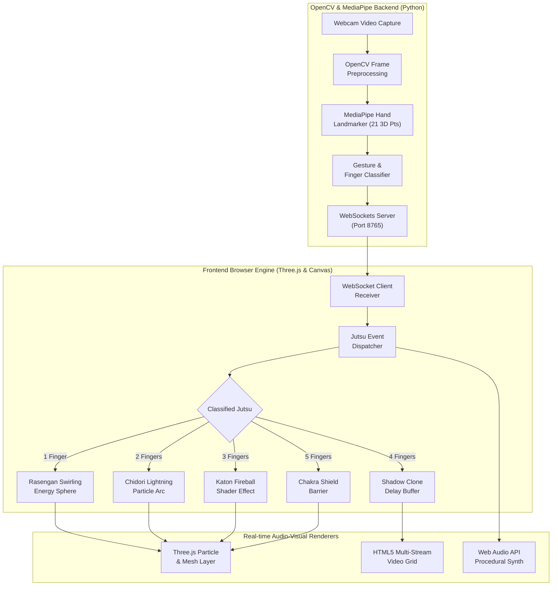

<p align="center">
  
</p>

# ◈ 3D Ninja : Jutsu

[](https://github.com/ISBANDURAHUMAN-R/NINJA-ACADEMY/actions/workflows/ci.yml)

## ◆ About the Project
3D Ninja : Jutsu is a computer vision web game that brings gesture-controlled training mechanics to life using real-time hand tracking and procedural rendering. By analyzing webcam video input through MediaPipe and OpenCV, the application translates physical finger counts into visual elemental effects and procedural audio.

## ❖ Key Features
- Real-time hand pose and skeletal tracking using Google MediaPipe and OpenCV.
- Finger counting gesture classifier mapping hand signs to specific actions (Rasengan, Chidori, Fireball, Substitution, and Shadow Clones).
- Time-delayed video cloning system that spawns multiple video feeds of the player.
- Three.js 3D overlay rendering visual particle spheres and shield meshes on tracked coordinates.
- Procedural audio synthesizer built with the Web Audio API for zero-latency sound effects.

## ◆ System Architecture


## ⬢ Technologies Used
- Python 3.9+
- OpenCV
- MediaPipe
- Three.js
- HTML5 Canvas & Web Audio API

## § Requirements
- Python 3.9 or higher
- Connected webcam
- Modern web browser

## ▲ Installation & Execution
```bash
# 1. Install Python dependencies
pip install -r requirements.txt

# 2. Launch Camera Server
python camera_server.py

# 3. Open Web Interface
# Navigate to http://localhost:8080 in Google Chrome or Microsoft Edge
```

## ※ Developer
Developer: ISBANDU RAHUMAN R  
GitHub: https://github.com/ISBANDURAHUMAN-R
